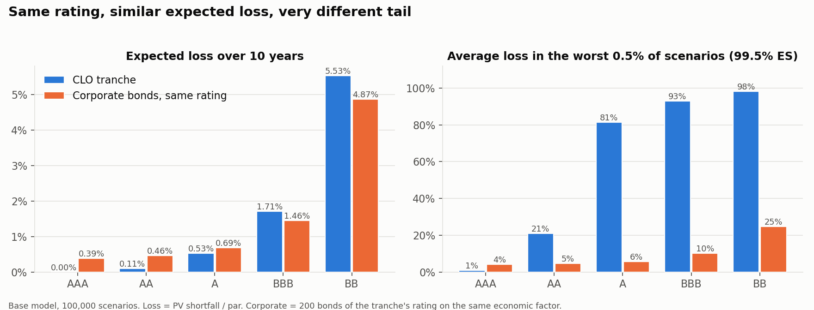
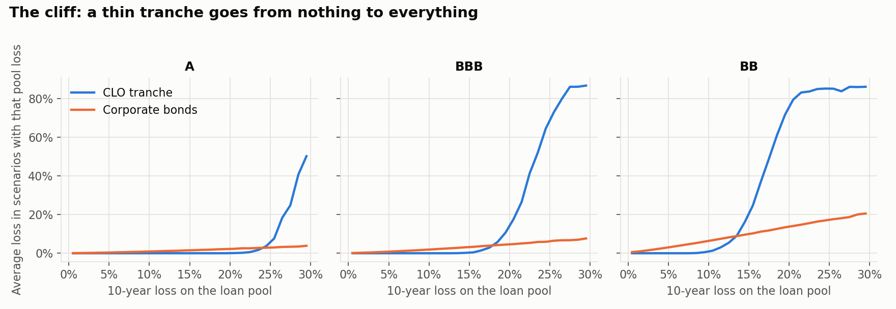
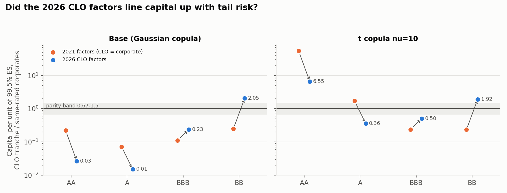
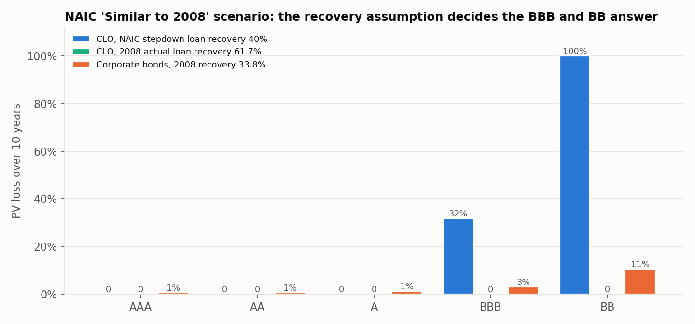
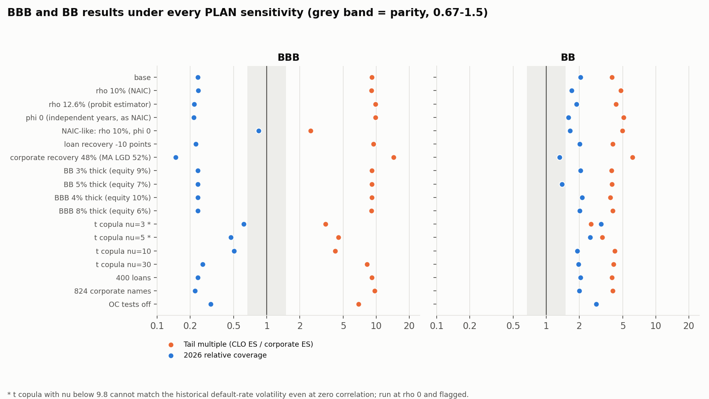

# Insurer CLO Holdings: Credit Risk vs. Capital Charges

U.S. insurers held $276.8 billion of CLO tranches at year-end 2024, 82% of it in life companies [11]. Through year-end 2025 a rated CLO tranche carried the same NAIC life RBC C-1 factor as a corporate bond with the same rating; for year-end 2026 the NAIC adopted CLO-specific factors [2]. This project builds a CLO and a same-rated corporate bond portfolio from scratch, puts both on one economic factor calibrated to 40 years of S&P default rates, and asks: for the same rating, how much more does the tranche lose in the tail, and how much tail does each dollar of capital cover under the old and the new factors?

The answer is a tail, not an average. Over 10 years a **BBB** tranche loses **1.71%** of par on average against **1.46%** for a portfolio of 200 BBB corporate bonds, but in the worst 0.5% of 100,000 scenarios it loses **93.0%** against **10.2%**: a tail **9.1 times** larger (4.2 times under a t copula). Under the 2021 factor both carried (1.523%), the tranche held about one-ninth as much capital per unit of tail loss. BB shows the same pattern (4.0 times); AAA tranches have *less* tail than AAA corporates in every variant. The 2026 CLO factors move in the right direction but miss on both sides: BBB doubles to 3.24% and still holds **0.23 times** the corporate capital per unit of 99.5% tail, below parity in 17 of 18 sensitivities (the exception is NAIC's own modelling assumptions); BB, at 25.15% plus the 11.77% thin-tranche surcharge, holds **2.05 times**. How large the gap is depends on two things NAIC's model fixes: the size of the default correlation (14.9% fitted here against NAIC's 10%) and whether bad years come in runs (NAIC draws each year independently; the S&P series has a year-to-year persistence of 0.51).



The model is harsher on CLOs than their record: it gives a BB tranche a 10.4% chance of losing principal within 10 years, while S&P counts 13 defaults among 2,497 CLO 2.0 BB tranches [21]. The finding is about the shape of the loss distribution under stress, not about historical default frequency. Every number in this README is in a CSV in `outputs/tables` (S&P and Moody's input tables are kept locally and not redistributed; see `data/licensed/README.md`); the main ones are collected in [`00_headline_numbers.csv`](outputs/tables/00_headline_numbers.csv). The question, method and decision rules were fixed in [`PLAN.md`](PLAN.md) before anything was run (its SHA-256 is checked in [`00_plan_hash.csv`](outputs/tables/00_plan_hash.csv)); the two places where the work departs from it are listed under [Deviations from the plan](#deviations-from-the-plan).

## Background: what changed at the NAIC

| Date | Event | Source |
|---|---|---|
| 30 Jun 2021 | Life RBC moves to 20 bond designation categories, factors from Moody's Analytics (1.A 0.158% to 5.C/6 30%); calibrated to the 96th percentile of loss over 10 years in excess of reserves | [1], [9] |
| 21 Feb 2023 | Valuation of Securities Task Force adopts SSG financial modelling of CLOs to remove "RBC arbitrage", originally effective YE2024; deferred to YE2025 (April 2024) and to YE2026 (adopted 10 Dec 2025) | [5], [6], [7] |
| 30 Jun 2023 | Residual (equity) tranches: 30% for YE2023, 45% from YE2024 | [3] |
| 23-30 Jun 2026 | RBC working group and Capital Adequacy Task Force adopt CLO-specific C-1 factors from the American Academy of Actuaries, effective YE2026 | [2], [10] |
| Jul-Oct 2026 | The Academy's proposal to keep CLO designations on agency ratings instead of SSG modelling is adopted up to NAIC Plenary; the matching P&P Manual amendment was exposed in August and on the 28 Oct 2026 working group agenda (outcome not found) | [8], [22] |

The Academy's own report says its results "make it inappropriate to apply corporate C-1 Factors directly to similarly rated CLO tranches" [10]. Its CLO model uses the bond model's Gaussian copula with 10% correlation and a fresh economic draw each year, and calibrates to the conditional tail expectation beyond the 90th percentile (CTE90) rather than VaR96 [10]. This project is an independent check of that change with a model whose correlation and persistence are fitted to data.

## Results

Base model: Gaussian copula, rho 14.9%, persistence 0.51, 100,000 scenarios, 10 years. Corporate = 200 ten-year bullet bonds of the tranche's rating on the same factor paths. Loss = 1 - PV(cash received) / par at the instrument's own coupon. "Tail multiple" = CLO 99.5% ES / corporate 99.5% ES; PLAN.md calls 1.5 or more "materially worse".

| Rating | EL, CLO | EL, corporate | P(any loss), CLO | 99.5% ES, CLO | 99.5% ES, corporate | Tail multiple | Class |
|---|---|---|---|---|---|---|---|
| AAA | 0.00% | 0.39% | 0.1% | 0.9% | 4.2% | 0.21 | CLO tail materially better |
| AA | 0.11% | 0.46% | 0.3% | 21.1% | 4.7% | 4.48 | CLO tail materially worse |
| A | 0.53% | 0.69% | 1.0% | 81.3% | 5.8% | 13.91 | CLO tail materially worse |
| **BBB** | **1.71%** | **1.46%** | 3.7% | **93.0%** | **10.2%** | **9.08** | CLO tail materially worse |
| **BB** | 5.53% | 4.87% | 12.7% | 98.2% | 24.8% | **3.97** | CLO tail materially worse |

Bootstrap 90% intervals for the ES figures are in [`02_loss_metrics.csv`](outputs/tables/02_loss_metrics.csv) (BBB tranche 92.4%-93.5%, BBB corporates 10.0%-10.5%).

The same table under the t copula (nu = 10, see the deviations section):

| Rating | EL, CLO | EL, corporate | 99.5% ES, CLO | 99.5% ES, corporate | Tail multiple | Class |
|---|---|---|---|---|---|---|
| AAA | 0.00% | 0.44% | 0.0% | 7.6% | 0.00 | CLO tail materially better |
| AA | 0.00% | 0.53% | 0.1% | 7.9% | 0.02 | CLO tail materially better |
| A | 0.03% | 0.78% | 5.3% | 9.1% | 0.59 | CLO tail materially better |
| BBB | 0.32% | 1.60% | 52.4% | 12.4% | 4.22 | CLO tail materially worse |
| BB | 2.61% | 5.08% | 87.9% | 20.7% | 4.24 | CLO tail materially worse |

By the PLAN's robustness rule (same class under both copulas), **BBB and BB are robust**: the CLO tail is materially worse under both. **AAA is robust the other way.** **AA and A are model-dependent**: worse under the Gaussian base, better under the t copula. The t copula that fits the data here has almost no correlation (rho 0.27%) and so almost no year-to-year persistence, which is what drives the AA and A tails in the base case.

### Why: the cliff



Group the scenarios by how much the loan pool lost over 10 years. The corporate portfolio's loss rises roughly in line with the economy. A tranche loses nothing until pool losses eat through the equity and the classes below it, and then goes most of the way to zero over a few points of pool loss: the BBB tranche goes from about 0% to over 80% as pool losses move from 15% to 28% ([`02_loss_vs_pool_loss.csv`](outputs/tables/02_loss_vs_pool_loss.csv)). Pool losses that large happen only in the worst few percent of scenarios (99.5th percentile 29.1%, mean 7.6%), so the tranche's expected loss stays close to the corporates' while its tail does not.

### Capital: the 2021 factors against the 2026 factors

Coverage = pre-tax C-1 factor / 99.5% ES. Relative coverage = CLO coverage / corporate coverage (1 = the tranche holds as much capital per unit of tail loss as a same-rated corporate; PLAN.md parity band 0.67-1.5). The base BB tranche is 4% thick and rated 3.B, so it attracts the 11.77% thin-tranche surcharge.

| Rating | Designation | 2021 factor (both) | 2026 CLO factor | Relative coverage, 2021 | Relative coverage, 2026 | 2026 verdict (base) | Gaussian vs t |
|---|---|---|---|---|---|---|---|
| AAA | 1.A | 0.158% | 0.040% | 4.74 | 1.20 | aligned | not robust (t: no CLO tail) |
| AA | 1.C | 0.419% | 0.050% | 0.22 | 0.03 | still under-capitalised | not robust (t: 6.55) |
| A | 1.F | 0.816% | 0.170% | 0.07 | 0.01 | still under-capitalised | robust (t: 0.36) |
| **BBB** | 2.B | 1.523% | 3.240% | **0.11** | **0.23** | **still under-capitalised** | robust (t: 0.50) |
| **BB** | 3.B | 4.537% | 36.920% | **0.25** | **2.05** | **more capital per unit of tail than corporates** | robust (t: 1.92) |



Read with care at AAA to A. The 2026 factors cut capital for those tranches to a quarter or less of the corporate factor (AAA 0.040% vs 0.158%, A 0.170% vs 0.816%). For AAA that matches this model, which finds the AAA tranche has less tail than AAA corporates. For AA and A it depends on whether the persistent-cycle tail of the base model is real; with NAIC's assumptions (below) their tails are small.

### The NAIC "Similar to 2008" scenario

The NAIC Capital Markets Bureau's 10-year default vectors for its "Similar to 2008" stress (Moody's-based, B2 13.6% in year 1 and 41.6% cumulative) applied to the pool, with NAIC's "stepdown" loan recovery of 40% [12], [13]. Corporates face the factor path implied by the same B2 vector. A second CLO column uses the 61.7% that first-lien loans actually recovered in 2008 [15].

| Rating | CLO principal loss, 40% recovery | CLO PV loss, 40% | CLO PV loss, 61.7% | Corporate PV loss (33.8% recovery) | NAIC's YE2019 result, principal / principal + interest |
|---|---|---|---|---|---|
| AAA | 0.0% | 0.0% | 0.0% | 0.6% | 0% / 0% |
| AA | 0.0% | 0.0% | 0.0% | 0.6% | 0% / 0% |
| A | 0.0% | 0.0% | 0.0% | 1.2% | 0% / 0% |
| BBB | 3.9% | 31.9% | 0.0% | 3.0% | 19% / 31% |
| BB | 100.0% | 100.0% | 0.0% | 10.6% | 97% / 148% |



AAA to A tranches come through a 2008-style decade untouched, as they did in practice [20]. Below that, the recovery assumption decides the answer: with 40% recoveries the pool loses 24.6% and the BB tranche is wiped out; with 2008's actual first-lien recoveries the pool loses 16.3%, the OC tests divert cash to the seniors for years, and every tranche, BB included, is eventually repaid. The BBB tranche's 31.9% PV loss under 40% recovery is mostly interest deferred and never repaid; its principal loss is 3.9%.

### Sensitivities (each changes one input from the base; all 18 are in PLAN.md)

| Variant | A tail multiple | BBB tail multiple | BB tail multiple | A rel. coverage 2026 | BBB rel. coverage 2026 | BB rel. coverage 2026 |
|---|---|---|---|---|---|---|
| **base** | 13.91 | 9.08 | 3.97 | 0.01 | 0.23 | 2.05 |
| rho 10% (NAIC) | 3.42 | 9.01 | 4.78 | 0.06 | 0.24 | 1.70 |
| rho 12.6% (probit estimator) | 9.57 | 9.81 | 4.32 | 0.02 | 0.22 | 1.89 |
| phi 0 (independent years, as NAIC) | 5.23 | 9.86 | 5.09 | 0.04 | 0.22 | 1.60 |
| **NAIC-like: rho 10%, phi 0** | **0.43** | **2.52** | 4.94 | 0.49 | **0.84** | 1.65 |
| loan recovery -10 points | 15.78 | 9.45 | 4.04 | 0.01 | 0.23 | 2.02 |
| corporate recovery 48% (MA LGD 52%) | 22.38 | 14.41 | 6.13 | 0.01 | 0.15 | 1.33 |
| BB 3% thick (equity 9%) | 13.91 | 9.08 | 3.96 | 0.01 | 0.23 | 2.06 |
| BB 5% thick (equity 7%) | 13.77 | 9.07 | 3.97 | 0.02 | 0.23 | 1.40 |
| BBB 4% thick (equity 10%) | 14.31 | 9.08 | 3.84 | 0.01 | 0.23 | 2.12 |
| BBB 8% thick (equity 6%) | 13.23 | 9.04 | 4.04 | 0.02 | 0.24 | 2.02 |
| t copula nu=3 (rho 0, too volatile) | 4.12 | 3.45 | 2.56 | 0.05 | 0.62 | 3.18 |
| t copula nu=5 (rho 0, too volatile) | 5.27 | 4.51 | 3.24 | 0.04 | 0.47 | 2.51 |
| t copula nu=10 | 0.59 | 4.22 | 4.24 | 0.36 | 0.50 | 1.92 |
| t copula nu=30 | 8.49 | 8.21 | 4.12 | 0.02 | 0.26 | 1.97 |
| 400 loans | 13.71 | 9.07 | 3.97 | 0.02 | 0.23 | 2.05 |
| 824 corporate names | 15.09 | 9.62 | 4.06 | 0.01 | 0.22 | 2.01 |
| OC tests off | 11.82 | 6.89 | 2.85 | 0.02 | 0.31 | 2.86 |



- **BBB and BB tails are materially worse than corporates in all 18 variants** (tail multiples 2.5-14.4 and 2.6-6.1). BBB's 2026 relative coverage stays below 0.67 in 17 of 18; only NAIC's own assumptions (rho 10% and independent years together) bring it to 0.84.
- **Each NAIC assumption alone barely moves BBB; together they do.** rho 10% alone: 0.24; phi 0 alone: 0.22; both: 0.84. With weaker correlation *and* no runs of bad years, a 10-year pool loss deep enough to reach the BBB tranche becomes very rare.
- **The thin-tranche surcharge prices thickness the model barely sees at 99.5%.** A 3%, 4% or 5% BB tranche has nearly the same 99.5% ES (98.1%, 98.2%, 98.4%), because all three are wiped out in the tail; the surcharge moves the 4% tranche's capital from 25.15% to 36.92% and its relative coverage from 1.40 (5% thick, no surcharge) to 2.05. Thickness does change how often the tranche is hit: 9.5% of scenarios at 3% (attachment 9%) vs 15.6% at 5% (attachment 7%).
- **OC tests matter**: without them the AA tranche's tail multiple rises from 4.5 to 10.3 and the BBB tranche's EL multiple from 1.17 to 3.33.

## Validation

`python -m pytest` runs 39 tests in about two seconds. Pass/fail criteria were fixed in PLAN.md section 6.

| Test | What | Result |
|---|---|---|
| V1 | Vasicek large-pool quantile vs closed form and a hand-checked value (p 1%, rho 20%, 99.9%: 14.5525%); copula marginals by quadrature and by name-level simulation; t copula tail dependence; cohort thresholds reproduce a cumulative curve; waterfall cash conservation (max error 5.6e-17 on the base run), zero loss without defaults, one-period waterfall = tranche formula, seniority, OC diversion, run-off; NAIC factor and surcharge rules | **pass** (39 tests) |
| V2 | Corporate model at NAIC-like settings (rho 10%, independent years, 824 names, recovery 48%), VaR96 - (EL + 0.5 SD), vs 2021 factors | AA 0.81x, A 0.53x **pass**; BBB 0.499x, BB 0.43x **fail** (needed 0.5x-2x) |
| V3 | CLO model at the same settings, CTE90 - same-rated corporate risk premium, vs 2026 factors | **fail**: BBB below zero, BB 0.09x |
| V4 | NAIC "Similar to 2008" vs NAIC's own YE2019 results | AAA, AA, A, BB **pass**; BBB principal loss 3.9% **fail** (band 5%-40%), though its PV loss of 31.9% is close to NAIC's principal + interest loss of 31% |
| V5 | 10-year probability of principal loss vs Moody's 2007-2017 CLO cohort and S&P CLO 1.0 / 2.0 counts | model above history at every rating (BB 10.4% vs Ba3 9%, Ba2 1%, CLO 1.0 3.9%, CLO 2.0 0.5%); nothing flagged as too optimistic |
| V6 | Default-weighted recovery in the simulation vs Moody's 1982-2009 issuer-weighted averages | loans 66.4% vs 65.6%; senior unsecured bonds 39.0% vs 36.6% |

**What the V2 and V3 failures mean.** The model is calibrated to S&P's default rates, and S&P's 10-year speculative-grade default rates are far below the Moody's-based rates the NAIC factors use: S&P 'B' 24.3% at 10 years [14] against 36.4% for B2 in NAIC's own "Historical" vectors built from Moody's cohorts [12]. A post-hoc diagnostic (not in the PLAN, reported separately in [`05_posthoc_moodys_pd.csv`](outputs/tables/05_posthoc_moodys_pd.csv)) re-ran the NAIC-like settings with the loan pool's default rates taken from those Moody's-based vectors: the model's BBB factor becomes 5.40% against NAIC's 3.24% (1.67x) and BB 47.4% against 36.9% (1.28x), both inside the 2x band. So the gap to the NAIC factors is mostly a default-rate source effect. Two consequences: the absolute 2026 BBB and BB factors are plausible under Moody's-based default rates; and the relative comparisons in this README (CLO against corporates with the *same* default-rate source) are the more reliable output of this model than its absolute capital numbers.

## Deviations from the plan

1. **t copula nu = 5 could not be calibrated.** PLAN.md asked for nu = 5 with rho re-solved to match the 3.24% volatility of the 'B' default rate. In a t copula every name shares one mixing variable each year, and at nu = 5 that variable alone produces a 4.65% standard deviation even with zero correlation, above the historical 3.24%; matching is possible only for nu of 9.8 or more ([`01_correlation.csv`](outputs/tables/01_correlation.csv)). Before any tranche result was seen, the t column was switched to the smallest feasible nu on the PLAN's sensitivity grid, **nu = 10** (rho 0.27%). nu = 3 and 5 are still reported, at rho = 0 and flagged as more volatile than history. PLAN.md itself is unchanged.
2. **One post-hoc diagnostic** (Moody's-based loan default rates, above) was added after V3 failed. It is labelled POST-HOC in its file and does not feed any headline number or decision.

## What the model does

**Economic factor (`src/clo/factor.py`, `copula.py`).** One systematic factor per year, a stationary AR(1) with unit variance; each name's latent variable is sqrt(rho) Z_t + sqrt(1 - rho) e_it (Gaussian) or that divided by sqrt(W_t / nu) (t). rho = **14.9%** solves "large-pool 'B' default rate has S&P's mean 3.34% and SD 3.24%" (1981-2020, [14]); the probit estimator on the same series gives 12.6%. The persistence phi = **0.51** is the lag-1 autocorrelation of probit-transformed annual 'B' default rates. The model's one-year 'B' default rate has a 99.5th percentile of 18.0% against a 40-year historical maximum of 13.8% (1991). Integrals over the factor use Gauss-Hermite quadrature, and over the t mixing variable adaptive quadrature, so calibrations are deterministic.

**Loan pool (`context.py`).** 200 first-lien loans in the rating mix of U.S. CLO collateral (LSEG Yield Book, May 2021, Moody's scale mapped to S&P notches [16], [4]: BB+ 3%, BB 5%, BB- 11%, B+ 14%, B 30%, B- 30%, CCC 7%). The Academy describes a typical pool as roughly B/B+ average quality [10]. Each rating has a constant annual default probability matching S&P's 10-year cumulative default rate for that notch [14]; pool average 3.08% a year. Defaults in a rating bucket are Binomial(loans, conditional PD), which is exact for identical loans and keeps 200-name granularity. During the 5-year reinvestment period recoveries are reinvested at par and defaulted names replaced; afterwards the pool runs off linearly to year 10 with no voluntary prepayment, as the Academy recommends [10].

**Recovery.** Linked to the economy: R = a + b x (speculative-grade default rate that year), fitted to Moody's yearly trading-price recoveries [15] against S&P's speculative-grade default rate [14]. Loans: slope -1.56, R-squared 0.24 (1990-2009), fitted 61.9% at the 2009 default rate. Bonds: slope -2.68, R-squared 0.47 (1982-2009), 30.8% in 2009.

**CLO (`waterfall.py`).** The Academy's illustrative structure [10]: AAA 64% / AA 12% / A 6% / BBB 6% / BB 4% / equity 8%, at SOFR + 130 / 140 / 160 / 260 / 500 bp, collateral at SOFR + 350 bp; SOFR 3.81% [19]; senior fee 0.20%, subordinated fee 0.30% [18]. OC tests after AA, A, BBB and BB interest at 122.6% / 114.5% / 108.9% / 103.7% from a published deal [17] (initial ratios 131.6% / 122.0% / 113.6% / 108.7%); a failing test diverts interest to pay down notes from the top. Unpaid interest is capitalised. A tranche's loss is 1 - PV(cash received) / par at its own coupon: zero whenever everything promised is paid, whatever the timing.

**Corporates (`corporate.py`).** 200 ten-year bullet bonds of one rating on the same factor paths, with yearly default thresholds solved so the portfolio reproduces S&P's average cumulative default curve for that notch in every year 1-10. With phi > 0 the survivors of a bad year are more likely to face another, so the naive thresholds would undershoot the curve; the tests check the solved ones hit it.

**Capital (`context.capital_factors`).** 2021 factors from 2021-11-L [1], 2026 CLO factors and the surcharge rule (2.C or below and 4% thick or thinner) from 2026-12-IRE MOD [2], rating to designation from the P&P Manual [4]; pre-tax throughout.

## Limitations

- **No rating migration or CCC haircut.** Loans default or survive; a real OC test marks down CCC holdings above 7.5% of the pool, which trips tests earlier (more protection for seniors, less for juniors).
- **No manager.** No trading gains or losses, no par building from discounted purchases, reinvestment at par. Real managers' par building is one reason CLO 2.0 tranches have done better than this model implies (V5).
- **Default-rate source.** S&P-based. Moody's-based rates are much higher at 10 years in speculative grade and would make every CLO tranche riskier in absolute terms (post-hoc diagnostic).
- **Persistence is fitted on 40 annual points.** phi = 0.51 has a wide sampling error, and it is what makes AA and A look risky in the base case.
- **One deal, one structure.** Insurers hold hundreds of CLOs whose pools overlap; there is no cross-deal diversification and no variation in structure, vintage or remaining reinvestment period.
- **Pre-tax, no AVR or portfolio adjustment.** The NAIC factors are after-tax calculations converted to pre-tax and sit on top of reserves; coverage here is factor / tail loss on the same pre-tax basis for both instruments.
- **Annual steps, constant SOFR, recoveries at the end of the year of default.**

## Sources

1. NAIC, RBC Proposal 2021-11-L (adopted 30 June 2021), life bond factors for 20 designation categories. https://content.naic.org/sites/default/files/inline-files/2021-11-L%20RBC%20Proposal.pdf
2. NAIC, RBC Proposal 2026-12-IRE MOD, CLO RBC factors (working group 23 June 2026, task force 30 June 2026; LR002 factor table and thin-tranche surcharge). https://content.naic.org/sites/default/files/inline-files/2026-12-ire.pdf
3. NAIC, RBC Proposal 2023-09-IRE, residual tranche factor (adopted 30 June 2023). https://content.naic.org/sites/default/files/inline-files/2023-09-IRE%20webpost_0.pdf
4. NAIC, Purposes and Procedures Manual of the Investment Analysis Office, December 2025, CRP rating equivalents (copy hosted by the Indiana Department of Insurance). https://secure.in.gov/idoi/files/Purposes-and-Procedures-Dec-2025.pdf
5. NAIC SVO memo, P&P Manual amendment to change the effective date for financial modeling of CLOs to 2025, 16 April 2024. https://content.naic.org/sites/default/files/inline-files/2024-007.01%20PP%20Manual%20CLO%20Effective%20Date.pdf
6. NAIC SVO memo, change of effective date to 2026, 13 August 2025. https://content.naic.org/sites/default/files/inline-files/2025-010.01%20%20PP%20Manual%20CLO%20Effective%20Date.pdf
7. NAIC Valuation of Securities (E) Task Force, 2025 Fall National Meeting summary (10 December 2025). https://content.naic.org/sites/default/files/national_meeting/2025-fanm-summary-e-vostf.pdf
8. NAIC SVO/SSG memo 2026-007.03, filing-exempt treatment of CLOs, revised 22 September 2026. https://content.naic.org/sites/default/files/inline-files/2026-007.03-pp-manual-part-four-clos-v4-new.pdf
9. Moody's Analytics, Revisions to the RBC C1 Bond Factors, May 2021. https://content.naic.org/sites/default/files/inline-files/2021%20Revisions%20to%20the%20RBC%20C1%20Bond%20Factors%205-24.pdf
10. American Academy of Actuaries, C-1 Subcommittee, Model Construction and Development of RBC C-1 CLO Factors, October 2026. https://actuary.org/wp-content/uploads/2026/10/life-report-CLOModelDoc.pdf
11. NAIC Capital Markets Bureau, U.S. Insurers' Total CLO Investments Pace of Growth Slows in 2024 (2 December 2025). https://content.naic.org/sites/default/files/capital-markets-special-report-clo-ye2024.pdf
12. NAIC Capital Markets Bureau, NAIC CLO Stress Tests (May 2020 Update): "Historical" and "2008" default vectors. https://content.naic.org/sites/default/files/capital-markets-clo-stress-tests.pdf
13. NAIC Capital Markets Bureau, CLOs: Stress Testing U.S. Insurers' Year-End 2019 Exposure, June 2020, Tables 9 and 10 (NAIC's link is retired; copy). https://retirementincomejournal.com/wp-content/uploads/2020/07/special_report_200618.pdf
14. S&P Global Ratings, Default, Transition, and Recovery: 2020 Annual Global Corporate Default And Rating Transition Study, 7 April 2021, Tables 1, 3, 4, 24, 26. https://www.spglobal.com/ratings/en/research/articles/210407-default-transition-and-recovery-2020-annual-global-corporate-default-and-rating-transition-study-11900573 (copy read: https://www.sfu.ca/~poitras/S&P_default_transition_20.pdf)
15. Moody's Investors Service, Corporate Default and Recovery Rates, 1920-2009, February 2010, Exhibits 7 and 21 (copy filed with the Manitoba PUB). https://www.pubmanitoba.ca/exhibits/mh2011/Volumes/app73.pdf
16. LSEG Yield Book, An Introduction to CLOs, June 2021, Exhibit 2. https://www.lseg.com/content/dam/data-analytics/en_us/documents/publications/an-introduction-to-clos.pdf
17. Academy Securities, OC Triggers: Subtle Thresholds, 4 April 2023. https://academysecurities.com/wp-content/uploads/Securitized_Special_Topics_OC_CLO.pdf
18. CIFC Corp., Form 10-K for 2014, Item 1 (senior management fees 15-20 bp, subordinated 30-35 bp). https://www.sec.gov/Archives/edgar/data/0001313918/000131391815000011/cifc123114.htm
19. Federal Reserve Bank of St. Louis, FRED series SOFR90DAYAVG, 10 November 2026. https://fred.stlouisfed.org/series/SOFR90DAYAVG
20. Moody's Investors Service, SEC Form NRSRO Exhibit 1 (2018), CLOs 10-year transition and default rates, 31 Dec 2007 to 31 Dec 2017. https://www.sec.gov/Archives/edgar/data/0001698547/000119312518101521/d558823dex99e1nrsro.pdf
21. Guggenheim Investments, Understanding Collateralized Loan Obligations (2025), S&P CLO 1.0 / 2.0 default counts as of 30 May 2025. https://portal.guggenheiminvestments.com/GuggenheimInvestments/media/PDF/Understanding-Collateralized-Loan-Obligations-2025.pdf
22. NAIC Investment Designation Analysis (E) Working Group, agenda for 28 October 2026 (draft 6 October 2026), item 2. https://content.naic.org/sites/default/files/call_materials/idawg-agenda-2025-10-28-v6_0.pdf

## Repository structure

```
PLAN.md             question, method, decision rules, fixed before any run
src/clo/
  copula.py         Gaussian / t one-factor copula, Vasicek closed forms, rho calibration
  factor.py         AR(1) factor paths, cohort default thresholds
  waterfall.py      annual CLO waterfall: defaults, recoveries, OC tests, reinvestment, run-off
  corporate.py      same-rated corporate bond portfolios
  risk.py           EL, VaR, ES, bootstrap
  context.py        inputs, calibration, one function that runs a variant, capital factors
scripts/
  01-07_*.py        pipeline steps, each writing CSVs to outputs/tables
  run_all.py        the whole pipeline, about 45 seconds, fixed seed 20261111
tests/              39 tests
data/raw/           public inputs (NAIC, FRED, SEC filings, industry papers), source in each file
data/licensed/      S&P and Moody's tables: kept locally, not in this repository (README explains how to rebuild)
outputs/tables/     every number above, as CSV
outputs/figures/    the five figures
```

Reproduce: `pip install -r requirements.txt`, then `python -m pytest` (runs without any licensed data). The full pipeline, `python scripts/run_all.py`, also needs the four S&P and Moody's tables in `data/licensed`; they are cited here but not redistributed, and [`data/licensed/README.md`](data/licensed/README.md) lists the exact tables and columns to rebuild them from the original reports. Every result they produce is already in `outputs/tables`.
